# ForgeMap

A **self-hosted**, read-only page that shows every project on your Gitea,
Forgejo and GitHub accounts: what is active, what is deployed, and what waits
on you.

[](https://github.com/Will-Luck/forgemap/releases)
[](LICENSE)
[](https://github.com/Will-Luck/forgemap/pkgs/container/forgemap)

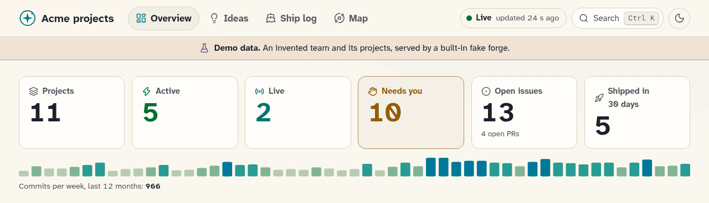

> - **Sign-in:** set up in the browser (the first way under Install), ForgeMap has one account. It always guards
>   **Settings**, and, with **Only me, after signing in** (the default; in Settings, **Ask for sign-in to see the
>   page**), the whole page, its JSON API and the feed.
> - **Shown to whoever may view:** repo names, issue and PR titles, commit messages and source errors; when
>   configured, also container names, probe URLs and note text.
> - **Private repos are hidden** by default; show them only while sign-in is on, or behind a login.
> - **A config file or the quick-start variables mean no sign-in:** anyone who can reach the page sees what it
>   shows. Keep it on your LAN or VPN, or behind a reverse proxy that asks for a login. See
>   [Privacy](https://github.com/Will-Luck/forgemap/wiki/Privacy-and-Security) for everything it shows.
> - **Examples:** [Docker Compose](https://github.com/Will-Luck/forgemap/wiki/Installation#docker-compose) and [behind a login](https://github.com/Will-Luck/forgemap/wiki/Installation#behind-a-login) with Caddy.

## Try it in one command

```bash
docker run --rm \
  -p 127.0.0.1:8080:8080 \
  ghcr.io/will-luck/forgemap -demo
```

Open http://127.0.0.1:8080 to see an invented team's projects from a
built-in fake forge: no token, no config, no network, and every page says it
is demo data.

## A quick tour

The header has four tabs: **Overview**, **Ideas**, **Ship log** and **Map**.

| Page | Where | Answers |
|---|---|---|
| [Overview](#overview) | Tab | What is going on? |
| [Needs you](#needs-you) | On the Overview | What do I need to do? |
| [Open issues](#open-issues) | The Overview's Open issues tile | What is open, and where? |
| [Project page](#project-page) | Open any project | Is it deployed and healthy? |
| [Ideas](#ideas) | Tab | What could we do next? |
| [Ship log](#ship-log) | Tab | What have we shipped? |
| [Map](#map) | Tab | How do projects relate? |
| [Setup and Settings](#setup-and-settings) | First start, then Settings | How do I set it up? |

### Overview

**Every project at a glance:** count tiles, a year of commits, what changed
since you last looked, and every project grouped by state.

The six states are Active, Live, On hold, Quiet, Dormant and Archived. The
page updates itself, and the header says **Live** or names a failing source.

Further down the Overview, every project is grouped by state, starting with
Active:

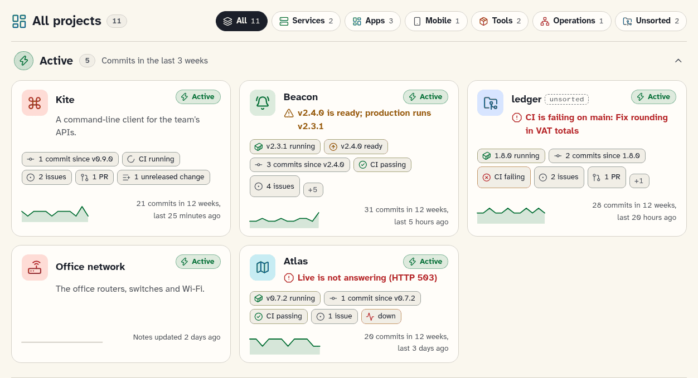

### Needs you

**What is waiting on you:** things to Fix, Deploy, Review, Confirm or
Decide, each naming its project and where it came from.

Cards come from your forges, Docker, probes, F-Droid, the projects file and
notes. On a forge, "you" is the token's user: to add a card, label an issue
`needs-you` or assign it to yourself.

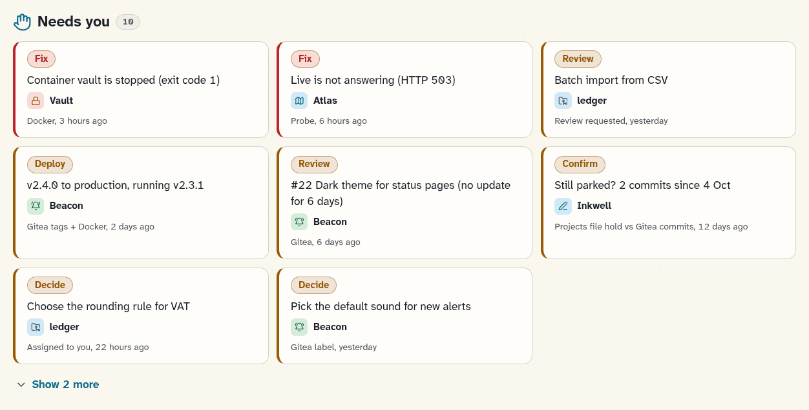

### Open issues

**Every open issue and pull request** the page holds, by project: the
Overview's **Open issues** tile opens it, and so does **Open issues** in
the search palette. A busy repo shows up to 50 of its issues and 50 of its
pull requests, listed newest updated first, and links to the rest on its
forge. On Gitea and Forgejo, and on a GitHub mirror or a GitHub forge with
no token, the issues are taken from the newest opened, not the newest
updated. A GitHub forge with no token lists no pull requests.

### Project page

**Everything about one project:** is it deployed, is it healthy, what is
left. You can tell without opening the forge.

**The top:** its state and why, then chips for versions, CI, issues, PRs and
plan progress.

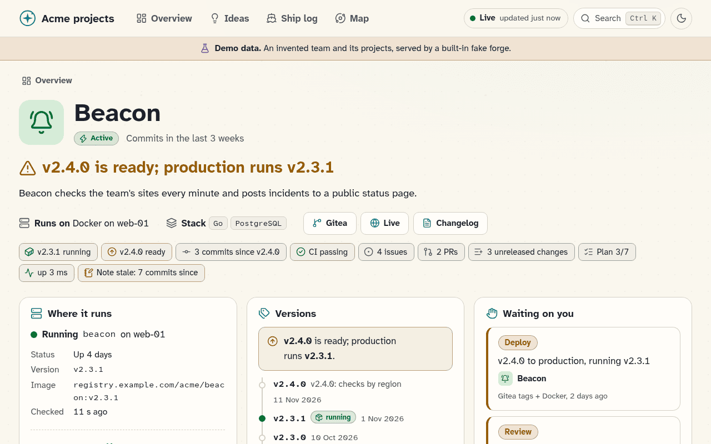

**Further down:** where it runs, and its versions with the running one
marked.

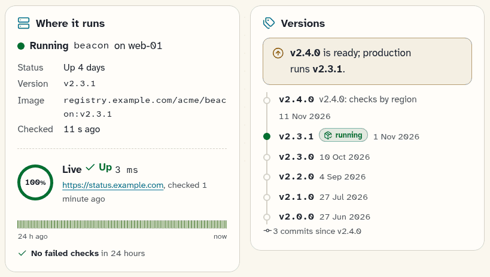

### Ideas

**Feature ideas** from issues labelled `idea` or `enhancement`, and from an
optional ideas file. Filter them by kind, size, filed or not and project, or
press **Surprise me**.

An idea that is not an issue yet has a **File as issue** button. With no
ideas set up, the page stays hidden.

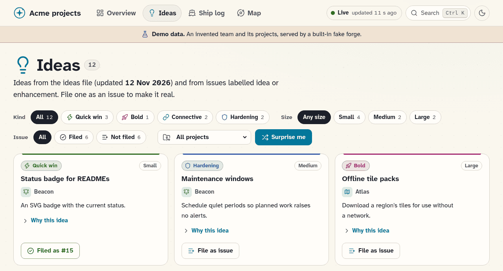

### Ship log

**A year of commits per day**, your busiest day and current streak, then
every release of the last 18 months, by month. **Last 30 days** beside the
releases, or the Overview's **Shipped in 30 days** tile, shows only the
releases that tile counts.

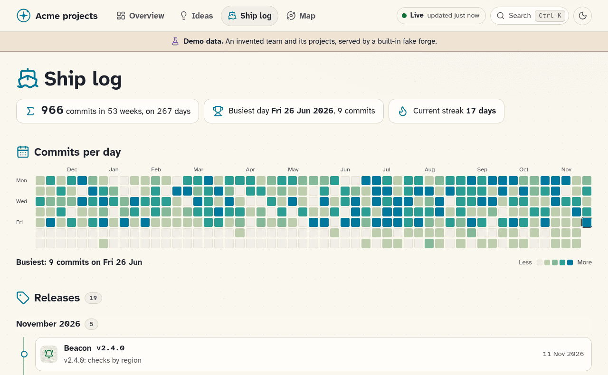

### Map

**Every project as a star**, grouped by category. Colour shows the state,
size shows the last 12 weeks of commits, and lines join related projects.

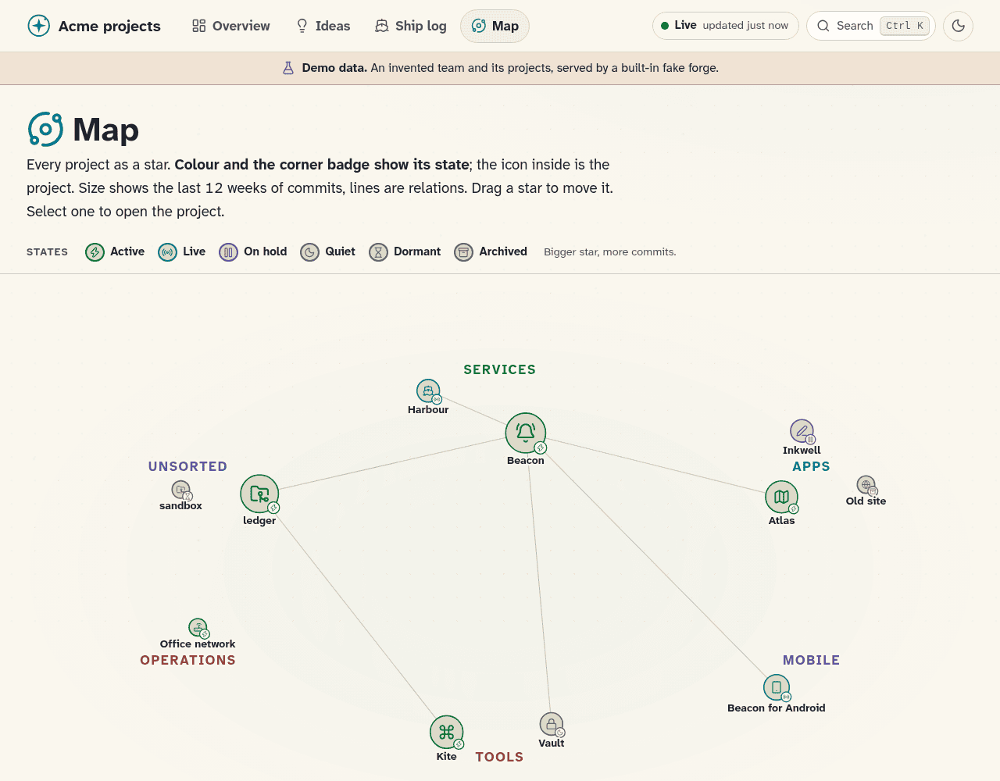

### Search

Press **Ctrl K** (Cmd K on a Mac, or **/**) and type a few letters to jump to
any project, idea or issue.

It also runs commands: **Refresh now** (unless `refresh: false` turns it
off), **Toggle theme** and **Surprise me**, and opens **Open issues**. On
an install set up with a config file or variables, typing **settings**
finds **Settings (off on this install)**, a link to how to move it to
Settings.

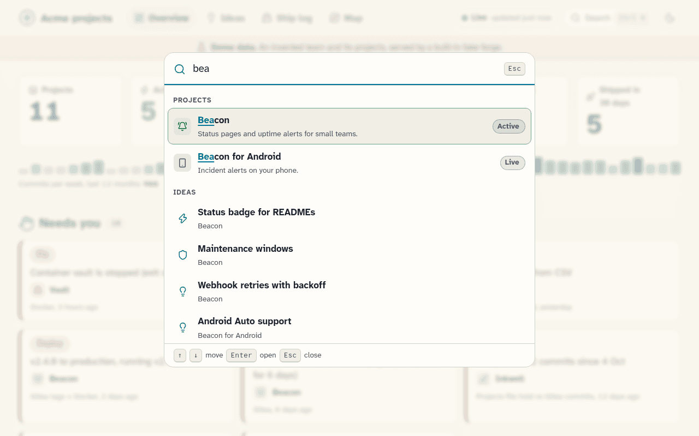

### Dark mode and phone

**Light or dark:** it follows your system until you press the sun or moon
button. Every page also fits a **phone**.

| Dark theme | On a phone |
|---|---|
| 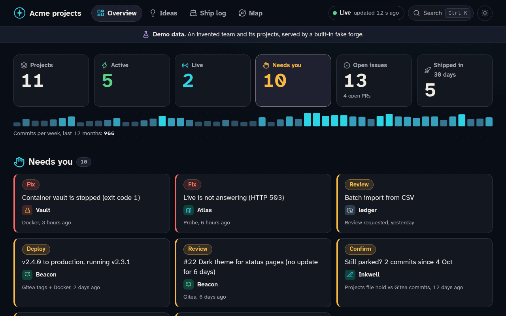 | 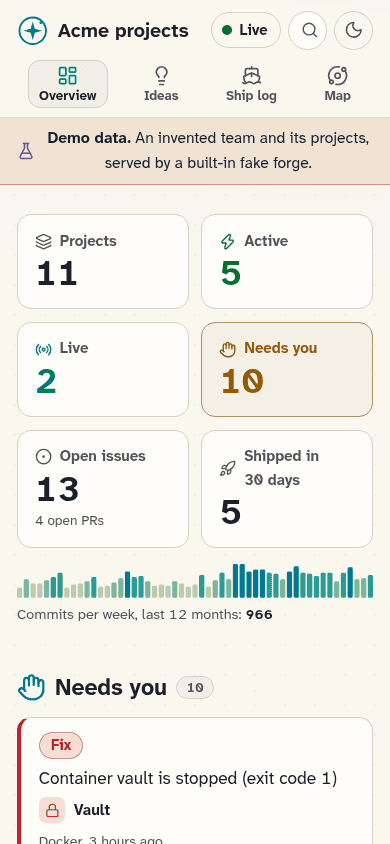 |

### Setup and Settings

**Set up in the browser:** make your account in the first 5 minutes after
the start and connect a forge. A GitHub forge can go without a token: it
then reads only the public repos your projects file names.

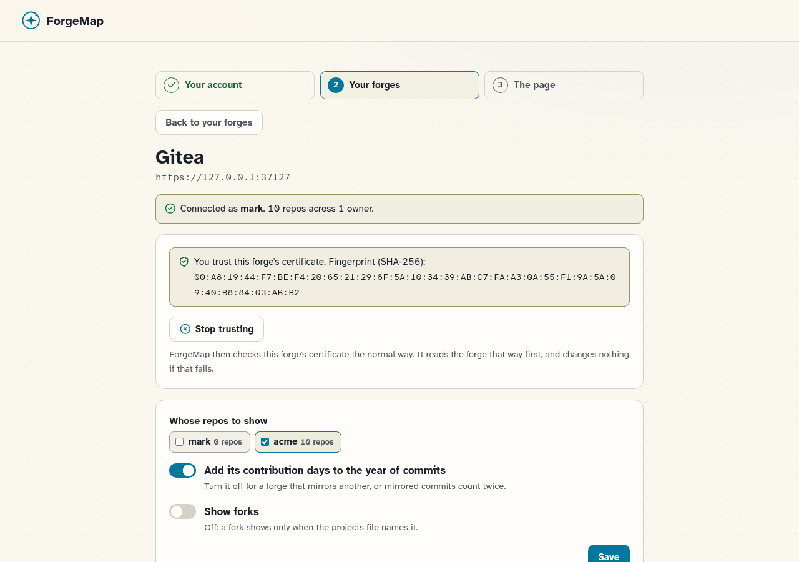

**Settings:** every setting in one place, applied without a restart.

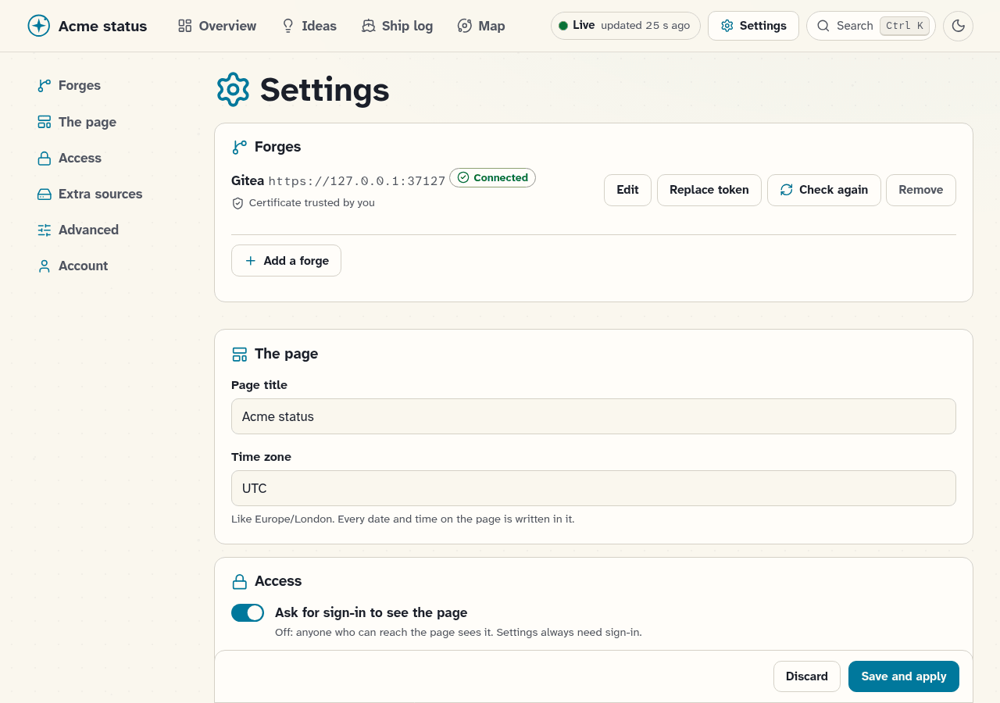

## What it reads

Nothing on the page is typed in by hand: every state comes from these
sources. ForgeMap needs no LLM and no database, and it **only reads**: it
never writes to a forge and never shows your token.

| Source | What it adds | Needed? |
|---|---|---|
| **Forges** (Gitea, Forgejo, GitHub) | Projects, versions, CI, issues, PRs, commits, plans, ideas | **Yes** |
| **Projects file** | Names, categories, grouped repos, holds, relations, URLs to probe | No |
| **Notes** folder | A notes panel on each project, and Decide items | No |
| **Docker** | Where each project runs, and its running version | No |
| **Probes** | Up or down, latency and 24-hour history for each URL | No |
| **F-Droid** | The published version of an Android app | No |

You need **at least one forge**. Without a projects file, each repo is a
project. Repo homepages are probed by default.

Every setting is in the [Configuration Reference](https://github.com/Will-Luck/forgemap/wiki/Configuration-Reference).

## Install

Each command publishes the port on `127.0.0.1` only. Finish setup before you
publish the port anywhere else.

**Set it up in the browser:** no token or config in the command.

<details>
<summary>Show the command</summary>

```bash
docker run -d --name forgemap --restart unless-stopped \
  -p 127.0.0.1:8080:8080 \
  -v forgemap-data:/data \
  ghcr.io/will-luck/forgemap:latest
docker logs forgemap
```

</details>

Open http://127.0.0.1:8080 within 5 minutes of the start (a restart opens
setup again), make your account and connect your forges. In those minutes
anyone who can open the page can make the account: do not publish the port
before it exists. Forgot the password?
`docker exec forgemap forgemap -reset-password`.

Or set it with variables or a file (no sign-in and no Settings page):

**GitHub only:** give it a read-only token and the owners to track, and each
of their public repos becomes a project (forks too, with
`-e FORGEMAP_FORKS=true`).

<details>
<summary>Show the command</summary>

```bash
docker run -d --name forgemap --restart unless-stopped \
  -p 127.0.0.1:8080:8080 \
  -e GITHUB_TOKEN=github_pat_... \
  -e GITHUB_OWNERS=your-user,your-org \
  -e TZ=Europe/Paris \
  -v forgemap-data:/data \
  ghcr.io/will-luck/forgemap:latest
```

</details>

**Gitea or Forgejo only:** give it your forge's address, a read-only token
and the owners to track.

<details>
<summary>Show the command</summary>

```bash
docker run -d --name forgemap --restart unless-stopped \
  -p 127.0.0.1:8080:8080 \
  -e GITEA_URL=https://git.example.com \
  -e GITEA_TOKEN=... \
  -e GITEA_OWNERS=your-user,your-org \
  -v forgemap-data:/data \
  ghcr.io/will-luck/forgemap:latest
```

</details>

**Both:** set both sets of variables or write a config file, and a repo with
the same name on both forges becomes one project.

<details>
<summary>Show the config file and the command</summary>

```yaml
# config/forgemap.yml
site:
  title: Team status
  timezone: Europe/Paris
include_private: false   # true shows private repos: a config file has no sign-in, so only behind a login
forges:
  - id: gitea
    type: gitea          # or forgejo
    url: https://git.example.com
    token: ${GITEA_TOKEN}
    owners: [acme]
  - id: github
    type: github
    token: ${GITHUB_TOKEN}
    owners: [acme]
    heatmap: false       # the mirrored commits are already counted on Gitea
```

```bash
docker run -d --name forgemap --restart unless-stopped \
  -p 127.0.0.1:8080:8080 \
  -e GITEA_TOKEN=... -e GITHUB_TOKEN=... \
  -v "$PWD/config:/config:ro" \
  -v forgemap-data:/data \
  ghcr.io/will-luck/forgemap:latest
```

</details>

Started from variables or a file, and want sign-in and Settings?
`docker exec forgemap forgemap -import-config` moves the install over with
its tokens and history: see [Moving to Settings](https://github.com/Will-Luck/forgemap/blob/main/docs/configuration.md#moving-to-settings).
Its step 2 runs the container again, with the same data volume and without
the config or the quick-start variables `GITEA_URL`, `GITEA_TOKEN`,
`GITHUB_TOKEN` and `GITHUB_OWNERS`, since any one left makes the next start
a quick start again. `docker restart` is not enough: it keeps them.

Token scopes, private repos, Docker options, images and binaries are in the
[install guide](https://github.com/Will-Luck/forgemap/wiki/Installation).

## Documentation

| Page | What is in it |
|---|---|
| [Install](https://github.com/Will-Luck/forgemap/wiki/Installation) | Each setup in full, token scopes, Docker, images and binaries |
| [Privacy](https://github.com/Will-Luck/forgemap/wiki/Privacy-and-Security) | Everything the page shows, and how to keep it private |
| [Features](https://github.com/Will-Luck/forgemap/wiki/Features) | States, the Needs you rules, notes, ideas, plans and containers |
| [FAQ](https://github.com/Will-Luck/forgemap/wiki/FAQ-and-Known-Limits) | Common questions and known limits |
| [Configuration](https://github.com/Will-Luck/forgemap/wiki/Configuration-Reference) | Every setting, its default and an example |
| [Changelog](CHANGELOG.md) | What changed in each release |

## About

ForgeMap started as a status page I built for my own homelab, to see all of
my projects in one place. I adapted it so anyone with Gitea, Forgejo or
GitHub can run it, in case others find it useful too.

Built with the help of Claude, which did pretty much all of the leg work.

## Licence

MIT. Made by Will Luck. See [LICENSE](LICENSE).
